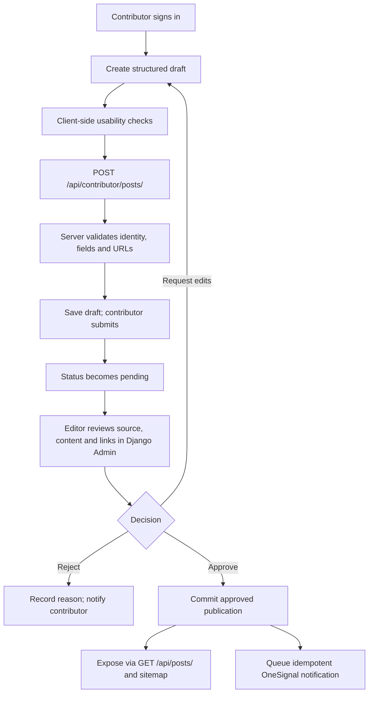

# BiharFast Application Flow and User Journeys

**Status:** Current journeys are distinguished from the planned contributor and Django editorial journeys.

## 1. Route map

| Intent | Current routes |
|---|---|
| Browse/search notices | `/`, `/jobs`, `/admit-card`, `/results`, `/sitemap`, `/all-updates` |
| Open a notice | `/post/:slug` |
| Explore services/education | `/rtps-bihar`, `/udyami-yojana`, `/bseb-matric-10th`, `/bseb-inter-12th`, `/kyp-bihar`, `/student-credit-card`, `/cuet-ug-admission` |
| Take a quiz | `/class-10-quiz`, `/mock-test/class-10`, `/mock-test` |
| Student session/history | `/dashboard` |
| Current administration | `/admin`, `/admin-portal` |
| Information/legal | `/about`, `/about-us`, `/contact`, `/contact-us`, `/disclaimer`, `/privacy-policy`, `/privacy`, `/terms`, `/terms-and-conditions` |

There is no dedicated `/schemes` route in the current route map; `schemes` is a supported notice category.

## 2. Visitor journey: find and act on a notice (current)

```mermaid
flowchart TD
  A[Open /] --> B[Fetch GET /api/notices]
  B --> C{Feed returned?}
  C -->|Yes| D[Search and filter loaded notices]
  C -->|No| E[Show fallback/error state]
  D --> F[Open /post/:slug]
  F --> G[Fetch GET /api/posts/{slug}]
  G --> H{Notice available?}
  H -->|Yes| I[Read summary and dates]
  I --> J[Follow apply or official PDF link]
  H -->|No| K[Show detail error state]
```

1. `AuthProvider` initializes above the routed application. The home feed requests `GET /api/notices` (or the configured API base URL).
2. FastAPI returns up to 50 active, published records. Search and category filtering operate on the loaded client-side list.
3. A selected notice opens at `/post/:slug`; the detail view fetches `GET /api/posts/{slug}`.
4. The visitor follows an explicit apply/PDF action to the destination. The app does not establish that all destinations are automatically verified.
5. The frontend may initialize OneSignal on supported production domains. Browser push permission is user-controlled; there is no current approval-event notification flow.

Feed/detail failure states should be visible. Feed/filter state is in-memory and is not retained in the URL or persisted after navigation/reload.

## 3. Student quiz journey (current)

1. The student opens a mock-test route; the UI requests available quizzes and/or quiz questions from `GET /api/quiz/available` and `GET /api/quiz/today`.
2. The backend returns public question text/options without answer keys.
3. The student enters the requested quiz details, answers in the player, and submits to `POST /api/quiz/submit`.
4. FastAPI loads the answer key and scores the attempt server-side. Non-demo attempts are subject to the daily per-IP limit and may be written to the leaderboard.
5. The result view presents score/answer review; the client fetches `GET /api/quiz/leaderboard/{quiz_id}`.
6. Student-specific attempt history is stored in browser localStorage (up to 50 attempts per user), not a server-side student history table.

## 4. Current admin journey: notice publication

1. An administrator opens `/admin` or `/admin-portal` and supplies the configured bearer credential.
2. The UI checks access using `GET /api/admin/posts`. The current FastAPI dependency accepts a valid Supabase JWT whose `profiles.role` is `admin` or `creator`; a configured legacy `ADMIN_API_TOKEN` is also accepted.
3. The administrator selects `jobs`, `admit_card`, `results`, or `schemes`; category selection changes labels and conditional fields.
4. The UI posts structured content to `POST /api/admin/posts`. FastAPI normalizes the create category, publishes the record, invalidates relevant cache, and may queue a Telegram alert.
5. Admin edits/status changes use `PUT /api/admin/posts/{post_id}` and `POST /api/admin/posts/{post_id}/status`.

This is not a student-contributor queue. The checked-in admin write path creates/publishes notices directly. The update path's category normalization does not preserve `schemes`, so editing a scheme must be corrected and tested before relying on it.

## 5. Planned contributor and editorial journey (Django/DRF target)



### Contributor steps

1. Authenticate through the contributor identity mechanism selected for Django; identity ownership and account-linking rules remain a prerequisite.
2. Draft title, category, source/official URL, eligibility, dates, and structured content.
3. Submit through the authenticated contributor API; the server validates required fields and permissions.
4. Submission enters `pending`; it is not returned by public feed/detail APIs.
5. Contributor sees their own submission and editorial status only.

### Editorial steps

1. An editor with Django permission opens `/admin` and filters the review queue by pending status/category.
2. The editor checks primary-source provenance, content quality, duplicate/plagiarism concerns, and destination URL behavior. Plagiarism and link validation are review requirements; automated tooling is not implemented.
3. The editor corrects, requests edits, rejects with a reason, or approves using a server-side permission-checked action.
4. Only an approved/published record becomes visible through `GET /api/posts/` and the sitemap.
5. After the database transaction commits, a retryable event dispatches the OneSignal notification. Push failure must not roll back publication.

The target state names (`draft`, `pending`, `approved`, `rejected`) describe a proposed editorial lifecycle. Current production visibility is based on active/published notice data; there is no Django Admin or contributor state machine in source.

## 6. State and persistence boundaries

| Data | Current owner | Planned owner / rule |
|---|---|---|
| Feed/search/filter state | React memory | Keep public browsing behavior; use URL state if shareable filters are introduced |
| Student login/session | Optional Supabase Auth | Do not migrate or duplicate without an explicit identity bridge |
| Admin access | Supabase JWT/profile role or configured legacy token | Django users/groups/permissions for contributor/editor administration after migration |
| Notice content | FastAPI + Supabase tables | Preserve existing data and public contracts; confirm schema before ORM mapping |
| Quiz answers/results | FastAPI + Supabase | Keep answer keys server-side; migration is not required for contributor launch |
| Student attempt history | Browser localStorage | Remains local until a separate privacy/retention-backed design is approved |
| Cache/rate limits | Optional Upstash Redis and backend fallback | Shared cache only for measured need; never cache personalized responses publicly |
| Push subscription | OneSignal/browser permission | Approval event triggers only after approved publication and commit |

## 7. Known journey gaps

- The footer calls `POST /api/subscribe`, but no corresponding FastAPI endpoint was identified.
- No contributor registration, submission endpoint, pending-review queue, Django Admin, approval action, plagiarism service, or approval push webhook is implemented.
- The application uses homepage WebSite/SearchAction JSON-LD; per-post structured data is not established by the route metadata flow.
- The React and FastAPI route behavior is current source behavior; the Django API paths in this document are target contracts.
