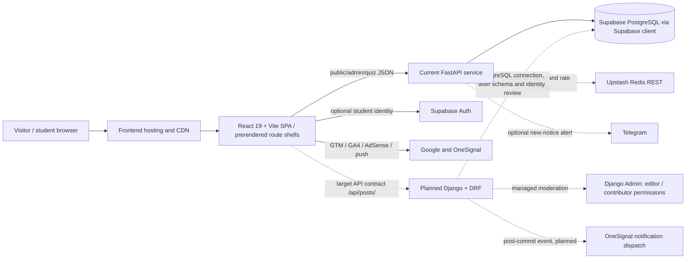

# BiharFast Technical Requirements and Architecture

**Status:** Current implementation plus a staged Django/DRF target. Future-state components are explicitly marked.

## 1. System context

The solid path is the implementation evidenced by source. Dashed paths are target architecture and must not be presented as deployed.

## 2. Technology stack

| Layer | Checked-in implementation | Target / constraint |
|---|---|---|
| Web client | React 19, Vite 8, Tailwind CSS 4, React Router, Lucide React | Retain SPA and established routes while migrating backend capabilities incrementally |
| SEO/PWA | Vite PWA/Workbox configuration, public service worker registration, prerender script, static and dynamic sitemap assets | Reconcile the generated Workbox worker and manually registered `/sw.js`; test install/update/offline behavior on deployed builds |
| API | Python FastAPI notice/admin endpoints and quiz router | Django 6 + Django REST Framework for contributor/editorial APIs, subject to runtime/dependency compatibility validation |
| Data | Supabase PostgreSQL accessed by Python Supabase client/PostgREST | Direct PostgreSQL connection/pooling from Django is a proposed migration path; verify connection URI, SSL, pooler mode, schema, and migration ownership first |
| Cache/rate limiting | Optional Upstash Redis REST cache/rate limiting; some in-process fallback behavior | Preserve graceful cache degradation; introduce shared cache for Django only where measured and needed |
| Hosting | Frontend Vercel configuration; backend URL `https://bihar-fast-portal.onrender.com`; Cloudflare is referenced in repository documentation | Confirm actual routing, CDN cache policy, and service health in deployment configuration before changing assumptions |

The root `package.json` is not the frontend application manifest; frontend scripts and dependencies are declared in `frontend/package.json`.

## 3. API contracts

### Current FastAPI API

| Method and path | Function |
|---|---|
| `GET /` | Health JSON |
| `GET /api/notices`, `GET /api/posts` | Active published notice feed (up to 50) |
| `GET /api/posts/{slug}` | Published notice detail |
| `GET /api/admin/posts` | Admin notice list |
| `POST /api/admin/ai/extract` | Admin PDF/raw-text extraction |
| `POST /api/admin/posts`, `POST /api/posts/create` | Create/publish notice |
| `PUT /api/admin/posts/{post_id}` | Update notice |
| `POST /api/admin/posts/{post_id}/status` | Change notice status |
| `DELETE /api/admin/posts/{post_id}` | Delete notice |
| `GET /api/sitemap-posts.xml` | Dynamic sitemap for published notices |
| `GET/POST /api/quiz/...` | Public quiz selection, submission, and leaderboard |
| `GET/POST/DELETE /api/quiz/admin/...` | Quiz administration |

The current admin dependency verifies a Supabase bearer JWT and `profiles.role` values `admin` or `creator`; a configured legacy `ADMIN_API_TOKEN` is also accepted. Quiz submission grades server-side and applies a non-demo daily IP limit.

### Target Django/DRF contract

Keep public URL semantics stable during the migration:

| Method and path | Target behavior |
|---|---|
| `GET /api/posts/` | Paginated active, approved/published posts; optional category/search filters |
| `GET /api/posts/{slug}/` | Public detail for approved/published posts only |
| `POST /api/contributor/posts/` | Authenticated contributor creates a draft/submission; never public by default |
| `GET /api/contributor/posts/` | Authenticated contributor lists only their submissions |
| `POST /api/contributor/posts/{id}/submit/` | Validated transition from draft to pending review |
| `GET /api/editor/posts/?status=pending` | Staff/editor queue |
| `POST /api/editor/posts/{id}/approve/` | Permission-checked approval and publish transition |
| `POST /api/editor/posts/{id}/reject/` | Permission-checked rejection with an editorial reason |

Use JSON request/response bodies, explicit validation errors, pagination, and documented category/status enums. The current API uses `/api/notices` and `/api/posts` feed aliases; adoption of the trailing-slash canonical target must preserve aliases or coordinate a client change. Do not claim these DRF endpoints exist until implemented.

## 4. Editorial, identity, and security requirements

### Planned RBAC

- **Contributor:** create and edit own drafts; submit for review; cannot publish or change another author's content.
- **Editor/staff:** inspect queue, edit submissions, approve/reject, and record a reason.
- **Administrator:** manage users, permissions, categories, and editorial settings.
- Enforce authorization in DRF permission classes and service/state-transition layer, not only by hiding Django Admin controls.
- Record author, reviewer, timestamps, transition, and decision reason. Restrict state transitions to allowed server-side paths.

### Identity migration

Current student identity is optional Supabase Auth; current admin authorization uses Supabase JWT plus profile role and possibly a legacy token. The target Django user model and role groups are not yet implemented. Before contributor rollout, choose an explicit identity ownership/bridge plan, account linking and recovery rules, session/JWT strategy, and retirement plan for the legacy token. Do not assume Supabase `profiles` can be mapped to Django users without a verified schema and migration.

### Security baseline

- Keep service-role/database credentials and Django secret keys server-side; use environment/hosting secret stores, never frontend variables.
- Require HTTPS, secure cookie/session settings, CSRF protection for session-authenticated writes, and narrowly scoped CORS.
- Apply request size limits, server-side validation, rate limits, audit logging, and safe HTML sanitization at write/render boundaries.
- Validate official URLs (scheme, hostname policy, redirects, DNS/IP protections) at the backend publication boundary. A helper exists in current code, but invocation on notice writes was not found.
- Keep quiz answer keys out of public responses and preserve backend scoring.
- Define Supabase RLS and Django database-role privileges from an exported schema and threat model; do not assume service-role access is protected by RLS.
- Current application integrations include GTM `GTM-MQVP93FK`, GA4 `G-2N03Q64SX9`, AdSense `ca-pub-2133187047291443`, and OneSignal `b7c92f29-666a-42e6-ba4b-5148849d773f`. Their presence is not proof of consent compliance or event coverage.

## 5. Third-party integration requirements

| Service | Current evidence | Requirement |
|---|---|---|
| AdSense | Meta verification/account ID `ca-pub-2133187047291443`, deferred loader, `frontend/public/ads.txt` | Keep seller declaration synchronized; validate ad slots, consent and Core Web Vitals impact before release |
| GTM | Container `GTM-MQVP93FK` in head and noscript container | Maintain one consistent container and document tags/events managed outside source |
| GA4 | Measurement ID `G-2N03Q64SX9` loaded after page load/idle | Define event schema and consent handling; do not treat loader presence as confirmed analytics coverage |
| OneSignal | Web SDK v16, app ID `b7c92f29-666a-42e6-ba4b-5148849d773f`, production-domain condition, `OneSignalSDKWorker.js` | Prompt only with user permission; planned approval dispatch must be post-commit, retryable, and idempotent |
| Search/crawlers | Canonical/meta shell, WebSite/SearchAction JSON-LD, prerendered metadata, robots/sitemaps, Vercel post SEO function | Validate per-route output; current static metadata lookup does not cover all parameterized paths |

Third-party loaders are deferred until page load/idle (with timeout fallback) in `frontend/index.html` to reduce critical-path work. `ads.txt` and a publisher ID indicate account configuration, not an actual ad placement.

## 6. Performance, availability, and observability

These are requirements/targets; no production measurements in this repository certify them.

- Product target: mobile page speed under 1.5 seconds, measured with an explicit metric and field/lab method (for Core Web Vitals, report p75 LCP/INP/CLS separately).
- API target: establish p50/p95/p99 by endpoint; the proposed sub-200ms API target requires load testing and must identify whether it is edge, service, or database response time.
- Cache public read-only feeds/details only with explicit TTL and invalidation; never share authenticated responses across users.
- Edge-cache immutable versioned frontend assets. Set public API/CDN TTLs only with verified purge behavior after publication.
- Add request IDs, structured logs, health/readiness checks, error tracking, latency/error dashboards, database/cache metrics, and alerts before claiming availability objectives.
- Redis is optional in the current implementation; cache failure must not silently return stale success-shaped data or prevent basic uncached reads.

## 7. SEO, PWA, and verification behavior

- Vite build runs `vite build` followed by `frontend/scripts/prerender.js`, which writes route-specific HTML metadata shells from `STATIC_ROUTE_METADATA`; it does not server-render route-specific React content.
- The backend exposes `/api/sitemap-posts.xml`; the frontend also checks in `sitemap.xml` and `sitemap-static.xml`. `frontend/public/robots.txt` permits crawling and lists sitemaps. The backend's own `/robots.txt` is a separate route that returns `Disallow: /`; do not confuse the two hosts.
- `backend/test_static_seo_prerender.py` checks generated route shell metadata when `frontend/dist` exists. `verify_30_urls_deep.py` and `verify_30_urls_full.py` make production URL checks when explicitly run; a checked-in JSON result is a timestamp-less snapshot, not a current health assertion.
- The Vite config declares PWA/Workbox behavior and the HTML registers a public `/sw.js`; test for worker conflicts, cache versioning, navigation fallback, and update behavior.
- The homepage has WebSite/SearchAction JSON-LD. Route-level structured data is not established by the current RouteSEO path, even though a metadata helper can accept schema.

## 8. Deployment configuration and open prerequisites

- Frontend API fallback: `https://bihar-fast-portal.onrender.com`; `VITE_API_BASE_URL` can override it. Vercel routing is configured in `frontend/vercel.json`.
- Frontend Supabase Auth config: `VITE_SUPABASE_URL`, `VITE_SUPABASE_ANON_KEY`.
- Backend Supabase credential resolution includes `SUPABASE_SECRET_KEY`, `SUPABASE_SERVICE_ROLE_KEY`, then `SUPABASE_KEY`; configure the least-privileged suitable secret.
- Optional integrations include Upstash REST credentials, `ADMIN_API_TOKEN`, and Telegram credentials.
- Before Django connects to Supabase PostgreSQL: export the correct project schema, verify pooler/direct URI mode and SSL, select migration ownership, test least-privilege access, and document rollback. Django `inspectdb` output is evidence to review—not authority to blindly apply migrations.
- The repository has no Django package, settings module, DRF app, Django Admin setup, or Django migrations at this time.
